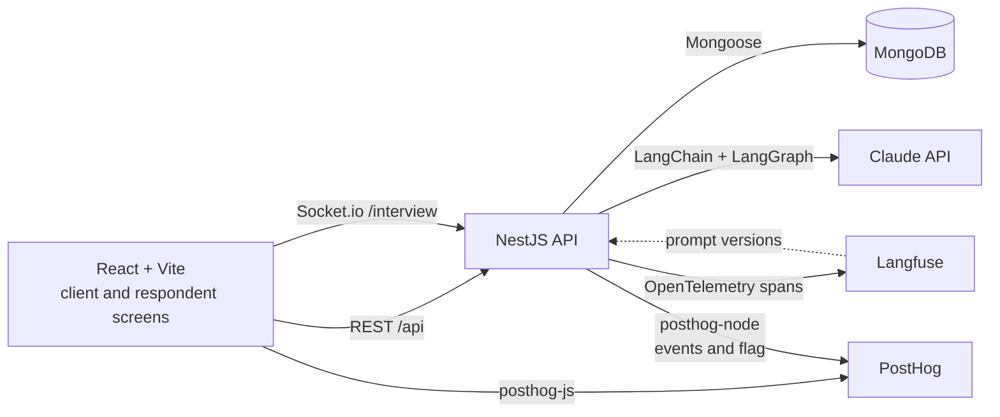
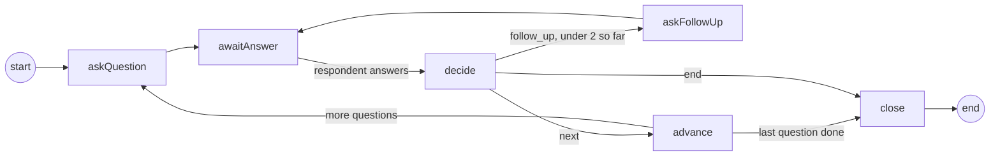

# Probe Lab

Probe Lab is a small app for AI-moderated consumer interviews. A client writes a research brief, Claude turns it into a questionnaire, an AI moderator interviews respondents in a chat, and the client gets a summary of themes with quotes.

I built it in three days as a study project, to learn NestJS, LangChain, LangGraph, Langfuse, PostHog and Socket.io by using them together. It is not production software and has never been used with real respondents.

## Status

| Day | Scope | State |
| --- | --- | --- |
| 1 | Scaffold, brief to questionnaire, questionnaire editor, launch, Langfuse tracing | Done |
| 2 | AI moderator (LangGraph) over Socket.io, respondent chat, PostHog funnel and flag | Done |
| 3 | Insights summary, eval datasets with before and after numbers, write-up | Built; the eval numbers and the funnel screenshot need a run with real keys |

## What works today

1. On the client screen, write a brief such as "Why are parents switching infant formula brands? UK mothers 25 to 40."
2. Claude drafts a questionnaire: a title, the audience, the topics, and 6 to 10 open questions, each with a goal. The output is validated against a zod schema, and an invalid draft is retried once.
3. Edit the questionnaire: reword, reorder, add or remove questions. Every save is a new version, so the generated draft is never overwritten.
4. Launch the study. The active version is frozen and you get a respondent link (`/s/<study id>`).
5. A respondent opens the link and an AI moderator interviews them in a chat. It asks each question in the questionnaire's exact wording, decides after every answer whether to probe further (at most 2 follow-ups per question), and streams its replies token by token. A reload picks up the same interview where it left off.
6. Back on the study page, open "Interviews and insights" and ask Claude for a summary of the completed interviews: an overview and a few themes, each backed by quotes. Every quote is checked word for word against the answer it cites before it is saved, and you can open the full answer behind any quote.

Two eval suites score the brief expansion and the moderator prompts in Langfuse, so a prompt change comes with before and after numbers (see [Evals](#evals)).

Every Claude call is traced in Langfuse with its prompt version, token usage, latency and cost. With a PostHog key set, every funnel step is captured in PostHog, and a feature flag picks the moderator prompt version per respondent.

## Architecture



```
apps/api          NestJS API
  src/studies         studies: create, edit the questionnaire, launch
  src/questionnaires  brief expansion chain and versioned questionnaires
  src/interviews      Socket.io gateway, interview service, moderator graph
  src/insights        summary chain, quote checking, versioned summaries
  src/analytics       PostHog events and the moderator prompt flag
  src/llm             Claude model factory, Langfuse tracing and prompts
  src/config          environment validation
  test/               end-to-end tests against a real MongoDB
  evals/              eval datasets, judges and the Langfuse experiment runner
apps/web          React + Vite client
  src/client          brief form, questionnaire editor, insights
  src/respondent      respondent chat
  src/lib             REST client and PostHog
packages/shared   zod schemas, DTO types and Socket.io event maps used by both apps
```

### The moderator

The moderator is a LangGraph graph. Its state holds the questions, the index of the current question, how many follow-ups it has asked on that question, every turn so far, and its last decision.



- **askQuestion** asks the next question in its exact wording. For the first question it adds a fixed intro; for later ones Claude writes a short bridge that acknowledges the last answer, and the question text follows it.
- **awaitAnswer** calls LangGraph's `interrupt()`. The graph saves a checkpoint to MongoDB and stops until the respondent answers.
- **decide** asks Claude, with structured output, whether the answer needs a follow-up, is enough to move on, or means the respondent wants to stop. It only sees the conversation about the current question.
- **askFollowUp** has Claude write one short, non-leading follow-up grounded in what the respondent said.
- **close** thanks the respondent, and the interview is marked completed.

The 2 follow-up cap is enforced in code by the router, not by the prompt: if Claude asks for a third follow-up, the graph moves on anyway. Only the three speaking nodes stream to the browser; the decision is never shown.

### The insights summary

1. The API collects every respondent answer from the study's completed interviews and lays them out question by question. Each answer gets a short reference such as `A12`, and an answer to a follow-up also shows the follow-up it replies to.
2. A LangChain chain (prompt, then Claude with JSON schema output, retried once) returns an overview and up to six themes. Each theme cites one to four quotes as `{ ref, text }`.
3. Code checks every quote against the answer its reference points to. A quote passes only if it is a run of whole words from that answer, ignoring case, spacing and curly versus straight quote marks. Quotes that fail are dropped and counted, and a theme left with no quote is dropped too.
4. The summary is saved as a new document with each quote's message id, so it can always be traced back to the exact answer in the `messages` collection.

The prompt asks for exact quotes, but the check in code is what guarantees them. The model cites short references rather than database ids because it copies a short label more reliably.

### Data model

Five collections, plus two that LangGraph owns.

- **studies**: the brief, a title, a status (`draft`, `live` or `closed`), the id of the active questionnaire version, and when it was launched.
- **questionnaires**: one document per version, never updated in place. Each holds the title, audience, topics and questions (each with a stable key such as `q3`, the text and the goal), plus where it came from: `generated` (with the prompt version, model and Langfuse trace id) or `edited`.
- **interviews**: one per respondent per study (a unique index enforces it). It points at the exact questionnaire version, and holds the respondent's anonymous id, the moderator prompt version the flag picked, the status and when it started and finished.
- **messages**: every turn of every interview, in order. Each has the role (`moderator` or `respondent`), the kind (`question`, `follow_up`, `closing` or `answer`), the question key it belongs to and the follow-up number. Summary quotes point at these message ids, so every quote can be traced back to a real answer.
- **summaries**: one document per generated summary, never updated in place. It holds the overview and the themes, each quote with its message id, interview id, question key and exact text, plus the quotes that failed the check and why, the prompt source and the Langfuse trace id.
- **moderator_checkpoints** and **moderator_checkpoint_writes**: the graph's saved state, written by LangGraph's MongoDB checkpointer and keyed by interview id.

Questions are embedded in their questionnaire version because they are always read together. Versions are separate documents because interviews point at the exact version they used, and evals compare generated drafts with what the client kept. Messages are their own collection, not an array on the interview, so the summary can query all answers to one question across a study.

### API

| Method | Path | What it does |
| --- | --- | --- |
| GET | `/api/studies` | List studies, newest first |
| POST | `/api/studies` | Create a draft study from a brief |
| GET | `/api/studies/:id` | A study and its active questionnaire |
| POST | `/api/studies/:id/questionnaire/generate` | Draft a questionnaire with Claude (20 to 60 seconds) |
| PUT | `/api/studies/:id/questionnaire` | Save edits as a new version (no-op if nothing changed) |
| POST | `/api/studies/:id/launch` | Freeze the questionnaire and open the study |
| GET | `/api/studies/:id/insights` | Interview counts and the latest summary |
| POST | `/api/studies/:id/insights` | Write a new summary from the completed interviews (20 to 60 seconds) |

### Socket.io events

The respondent chat uses the `/interview` namespace. The browser sends its PostHog distinct id in the handshake, and that id is the respondent's identity. Each interview has a room, so two open tabs see the same conversation. Both directions are typed by event maps in `packages/shared/src/interview.ts`, which the gateway and the React hook both import.

| Direction | Event | Payload |
| --- | --- | --- |
| Browser to API | `interview:join` | `{ studyId }`, acknowledged with the interview and its transcript so far |
| Browser to API | `interview:answer` | `{ interviewId, text }`, acknowledged with the saved answer |
| API to browser | `moderator:delta` | A piece of the moderator's reply while it streams |
| API to browser | `moderator:done` | The finished, saved message |
| API to browser | `interview:progress` | Which question the moderator is on |
| API to browser | `interview:completed` | The interview is over |
| API to browser | `interview:error` | Something failed; the chat offers to try again |

## Running it locally

You need Node 22, pnpm 10 (`corepack enable` gives you the version pinned in `package.json`) and Docker.

```sh
cp .env.example .env     # then add ANTHROPIC_API_KEY, and the Langfuse and PostHog keys if you want them
pnpm install
docker compose up -d     # MongoDB on localhost:27017
pnpm dev                 # API on :3000, web on :5173
```

Open http://localhost:5173, create and launch a study, then open its respondent link. The link works in the same browser, so one person can play both the client and the respondent.

Without `ANTHROPIC_API_KEY` everything that does not call Claude still works, and the app says the key is missing. Without the Langfuse keys tracing is off and prompts come from the repo. Without the PostHog key analytics are off and every interview uses moderator prompt v1.

### Prompts in Langfuse (optional)

Prompts live in the repo (for example `apps/api/src/questionnaires/brief-expansion.prompt.ts` and `apps/api/src/interviews/moderator/moderator.prompts.ts`) and can be pushed to Langfuse Prompt Management:

```sh
pnpm prompts:push
```

Each variant becomes a Langfuse prompt version labelled `v1`, `v2` and so on, and the production variant also gets the `production` label. Brief expansion and the moderator's bridge prompt ask Langfuse for `production`. The moderator's decide and follow-up prompts ask for the label the PostHog flag picked (`v1` or `v2`). All of them fall back to the repo copy if Langfuse is unreachable, and each trace is tagged with where its prompts came from, for example `langfuse:3` or `moderator-decide@repo:v1`.

If Langfuse shows no cost for the model, add a custom model price under Settings > Models in your Langfuse project.

### PostHog (optional)

1. Put your project key and host in `.env` (`POSTHOG_PROJECT_KEY`, `POSTHOG_HOST`). The web app reads the same two values.
2. Create a feature flag with the key `moderator-prompt-version`. Make it multivariate with two variants, `v1` and `v2`, at 50% each, released to 100% of users.
3. Build a funnel insight with these steps, in order:

| Step | Event | Sent from |
| --- | --- | --- |
| 1 | `brief_submitted` | Browser, after the study is created |
| 2 | `questionnaire_generated` | API |
| 3 | `questionnaire_edited` | API, only when a save changed something |
| 4 | `study_launched` | API |
| 5 | `interview_started` | API, when an interview is created |
| 6 | `interview_completed` | API |
| 7 | `summary_viewed` | Browser, when a summary is shown on the insights page |

The browser owns the distinct id: posthog-js creates it, and the web app sends it to the API in an `x-posthog-distinct-id` header on REST calls and in the Socket.io handshake. Server events therefore land on the same person as browser events. Every event also carries the study as a PostHog group (`study`), so the same funnel can be aggregated by study instead of by person.

The funnel counts one person moving through all seven steps, which only happens when the same browser plays both roles. That is how I test it, and it is a known limit of the demo; see "What I'd do next".

`interview_started` and `interview_completed` carry `prompt_version` and `$feature/moderator-prompt-version`, so the funnel can be broken down by flag variant to compare completion rates for v1 and v2.

## Tests

```sh
pnpm test        # unit tests: schema rules, chains, moderator graph, quote checks, eval scoring
pnpm test:e2e    # API end to end against MongoDB (run docker compose up -d first)
```

- The schema tests cover question counts, key assignment for edited questionnaires, and trimming.
- The chain tests run the real LangChain chain against a stubbed Anthropic client. They check that the request uses JSON schema output, that the brief reaches the prompt, and that an invalid draft is retried exactly once.
- The quote check tests cover exact excerpts, the edits models make around a quote (quote marks, ellipses at the ends, curly apostrophes, collapsed spaces), and the rejections: an unknown reference, a quote from a different answer, a paraphrase, a stitched quote and part of a word.
- The moderator graph tests run the real compiled graph with an in-memory checkpointer and scripted decisions. They cover the routing table, the intro and exact question wording, the follow-up cap, that `decide` only sees the current question, early stop, closing after the last question, and that only speaking nodes stream.
- The studies e2e test drives the whole client flow through HTTP with the model stubbed: create, generate, edit, save without changes, launch, and the lock after launch.
- The interviews e2e test connects a real Socket.io client to the running API with the moderator's chains scripted. It plays a full interview (streamed deltas, progress, a follow-up, an early stop), rejoins to check the saved transcript, and checks the refusals: an answer after completion, an empty answer, another respondent's interview, and a study that is not live.
- The insights e2e test seeds a completed and an unfinished interview and scripts the summary model to return one real quote, one paraphrase and one quote under a made-up reference. Only the real quote survives, it points at the right message, and the unfinished interview never reaches the model.
- The eval tests run both suites end to end against a fake Claude client (prompt loading, chains, judges, evaluators), check the scoring rules, and check the before and after table.

CI runs typecheck, both test suites and the build on every pull request, then boots the built API to catch problems that only show up in the compiled output. It needs no API keys.

## Evals

Two suites run as Langfuse experiments. Each one syncs its test cases from the repo to a Langfuse dataset, runs the real chain on every case, scores the output with code and with Claude as a judge, and writes the scores to `apps/api/evals/results/`.

**Brief expansion** runs the real brief expansion chain on ten briefs (`evals/brief-expansion.dataset.ts`). Two of them already assume their answer ("we think shoppers love our new packaging"), to tempt the model into leading questions, and several list many topics. Every brief has a hand-written list of topics a good guide must cover.

| Score | What it measures |
| --- | --- |
| Questions not leading | Share of questions the judge did not flag as leading: suggesting an answer, assuming feelings, flattering the product, or pushing towards agreement |
| Questions not duplicated | Share of questions that do not repeat an earlier one, meaning a respondent would answer both the same way |
| Brief topics covered | Share of the hand-written topics that at least one question would get the respondent talking about |

**Moderator** runs the moderator's decide and follow-up chains on twelve scripted moments of an interview, right after the respondent answers (`evals/moderator.dataset.ts`). Seven call for a follow-up (vague, short, or with a detail worth exploring, some with emotion that invites a leading probe), three are complete answers and two are requests to stop. For the seven, the suite also writes a follow-up and scores it.

| Score | What it measures |
| --- | --- |
| Follow-ups grounded in the answer | The follow-up picks up something specific the respondent said, rather than a generic "tell me more" |
| Follow-ups not leading | The follow-up does not suggest an answer, assume feelings or judge |
| Follow-ups a single short question | Exactly one question mark and at most 30 words (code, no judge) |
| Decision matches the label | `follow_up`, `next` or `end`, against the hand-written label |

### The change under test

Each prompt under test has a v1 and a v2 that differ in one thing, chosen before the first run as a hypothesis:

- **Brief expansion v2** adds two examples to the rule against leading questions (a leading question and its neutral rewrite). Expected: more questions not leading, with coverage unchanged.
- **Moderator follow-up v2** adds one rule: build the follow-up on one specific thing the respondent said, in their own words. Expected: more grounded follow-ups, without more leading ones. The decide prompt is the same in v1 and v2, so its score shows how much the numbers move between runs by chance.

If the v1 run shows a different weakness, change v2 to target that instead and run again; the command below makes that cheap. The moderator v2 is also what the PostHog flag serves to half of respondents, so the funnel can show whether it changes completion.

### Running them

You need `ANTHROPIC_API_KEY` and the Langfuse keys in `.env`.

```sh
pnpm prompts:push               # optional, links each generation to its Langfuse prompt version
pnpm evals                      # both suites, v1 then v2
pnpm evals:report --write       # puts the table below into this README
```

`pnpm evals moderator --variant v2` runs one suite on one variant, and `--limit 2` runs only the first two cases to check the wiring cheaply (those results are not saved over the real ones). A full run is about 120 Claude calls, including the judge calls. Each run prints a link to its experiment in Langfuse, where the v1 and v2 runs on the same dataset can be compared item by item, with each trace and its cost.

The judges' prompts are part of the measuring stick, so they stay the same between runs and live in code (`evals/judges.ts`), not in Langfuse.

### Results

<!-- eval-results:start -->
Not run yet. I built and tested the eval harness without API keys, against a fake Claude API and a fake Langfuse server, so these numbers appear after the first run with real keys.
<!-- eval-results:end -->

With ten and twelve cases, one run each, and an LLM judge, a change of a few points is within noise. A real decision would want several runs per variant and a check of the judge against hand labels.

## Product analytics

All seven funnel events and the flag are in place (see [PostHog](#posthog-optional) above). The funnel screenshot goes here once a few studies have been run end to end with a real PostHog project; I have not been able to capture one without keys.

## What I'd do next

- Drafting a questionnaire is a 20 to 60 second HTTP request. A job queue with progress over a socket, or streaming the draft into the editor, would feel better and survive a page refresh.
- There is no auth: every study belongs to one hard-coded demo client, and a respondent is whoever holds a browser's PostHog id. Real respondents would get signed, single-use invite links.
- The funnel mixes the client's and the respondent's steps on one person. In a real product they are different people, so the funnel would be split in two (client: brief to launch; respondent: started to completed) or joined on the study group.
- Only one moderator turn runs per interview, enforced by an in-memory lock. That is fine for one API process; with several, the lock would move to MongoDB or Redis.
- An interview that the respondent walks away from stays `in_progress` forever. A scheduled job should mark it `abandoned` after a timeout so the funnel and the summary can tell the difference.
- If the API restarts while the moderator is speaking, the half-streamed reply is lost and the turn reruns when the respondent reconnects. That works, but the respondent sees the reply start again.
- The questionnaire editor sends the whole questionnaire on save. Fine at this size, but a real editor would want optimistic updates and conflict handling.
- The summary prompt holds every answer in the study. That is fine for a handful of interviews; for hundreds, summarise each question first and then combine, or cluster the answers before Claude sees them.
- The summary itself has no eval yet. Each saved summary already records how many quotes failed the check and why, so a small dataset of transcripts would turn that into a score.
- The evals run once per variant. Three runs each, with the spread reported, and a judge checked against my own labels on a sample would make small differences trustworthy.
- Prompt changes could run the evals in CI on a small subset, behind a label, since every run costs money.

## Notes

[NOTES.md](NOTES.md) has what each new tool does, what surprised me, and what I would do differently.
