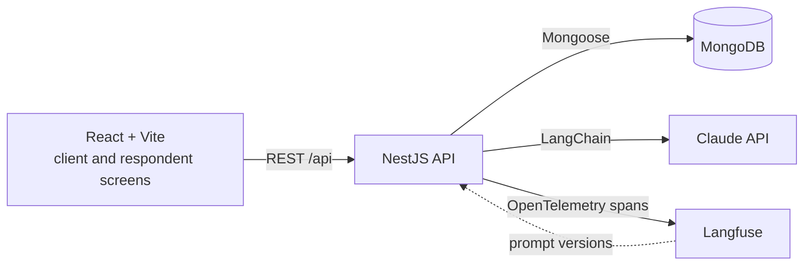

# Probe Lab

Probe Lab is a small app for AI-moderated consumer interviews. A client writes a research brief, Claude turns it into a questionnaire, an AI moderator interviews respondents in a chat, and the client gets a summary of themes with quotes.

I built it in three days as a study project, to learn NestJS, LangChain, LangGraph, Langfuse, PostHog and Socket.io by using them together. It is not production software and has never been used with real respondents.

## Status

| Day | Scope | State |
| --- | --- | --- |
| 1 | Scaffold, brief to questionnaire, questionnaire editor, launch, Langfuse tracing | Done |
| 2 | AI moderator (LangGraph) over Socket.io, respondent chat, PostHog funnel and flag | Not started |
| 3 | Insights summary, eval datasets with before and after numbers, write-up | Not started |

## What works today

1. On the client screen, write a brief such as "Why are parents switching infant formula brands? UK mothers 25 to 40."
2. Claude drafts a questionnaire: a title, the audience, the topics, and 6 to 10 open questions, each with a goal. The output is validated against a zod schema, and an invalid draft is retried once.
3. Edit the questionnaire: reword, reorder, add or remove questions. Every save is a new version, so the generated draft is never overwritten.
4. Launch the study. The active version is frozen and you get a respondent link. The respondent chat behind that link arrives on Day 2.

Every Claude call is traced in Langfuse with its prompt version, token usage, latency and cost.

## Architecture



```
apps/api          NestJS API
  src/studies         studies: create, edit the questionnaire, launch
  src/questionnaires  brief expansion chain and versioned questionnaires
  src/llm             Claude model factory, Langfuse tracing and prompts
  src/config          environment validation
  test/               end-to-end tests against a real MongoDB
apps/web          React + Vite client
  src/client          brief form and questionnaire editor
  src/respondent      respondent chat (Day 2)
packages/shared   zod schemas and DTO types used by both apps
```

The `interviews` and `insights` modules join `apps/api` on Days 2 and 3.

### Data model

Two collections so far.

- **studies**: the brief, a title, a status (`draft`, `live` or `closed`), the id of the active questionnaire version, and when it was launched.
- **questionnaires**: one document per version, never updated in place. Each holds the title, audience, topics and questions (each with a stable key such as `q3`, the text and the goal), plus where it came from: `generated` (with the prompt version, model and Langfuse trace id) or `edited`.

Questions are embedded in their questionnaire version because they are always read together. Versions are separate documents because interviews (Day 2) will point at the exact version they used, and evals compare generated drafts with what the client kept.

### API

| Method | Path | What it does |
| --- | --- | --- |
| GET | `/api/studies` | List studies, newest first |
| POST | `/api/studies` | Create a draft study from a brief |
| GET | `/api/studies/:id` | A study and its active questionnaire |
| POST | `/api/studies/:id/questionnaire/generate` | Draft a questionnaire with Claude (20 to 60 seconds) |
| PUT | `/api/studies/:id/questionnaire` | Save edits as a new version (no-op if nothing changed) |
| POST | `/api/studies/:id/launch` | Freeze the questionnaire and open the study |

## Running it locally

You need Node 22, pnpm 10 (`corepack enable` gives you the version pinned in `package.json`) and Docker.

```sh
cp .env.example .env     # then add ANTHROPIC_API_KEY, and the Langfuse keys if you want traces
pnpm install
docker compose up -d     # MongoDB on localhost:27017
pnpm dev                 # API on :3000, web on :5173
```

Open http://localhost:5173.

Without `ANTHROPIC_API_KEY` everything except drafting a questionnaire works, and the app says the key is missing. Without the Langfuse keys tracing is off and prompts come from the repo.

### Prompts in Langfuse (optional)

Prompts live in the repo (for example `apps/api/src/questionnaires/brief-expansion.prompt.ts`) and can be pushed to Langfuse Prompt Management:

```sh
pnpm prompts:push
```

Each variant becomes a Langfuse prompt version labelled `v1`, `v2` and so on, and the production variant also gets the `production` label. The API asks Langfuse for `production` and falls back to the repo copy if Langfuse is unreachable. Each trace is tagged with where its prompt came from, for example `langfuse:3` or `repo:production`.

If Langfuse shows no cost for the model, add a custom model price under Settings > Models in your Langfuse project.

## Tests

```sh
pnpm test        # unit tests: questionnaire schema rules, brief expansion chain
pnpm test:e2e    # API end to end against MongoDB (run docker compose up -d first)
```

- The schema tests cover question counts, key assignment for edited questionnaires, and trimming.
- The chain tests run the real LangChain chain against a stubbed Anthropic client. They check that the request uses JSON schema output, that the brief reaches the prompt, and that an invalid draft is retried exactly once.
- The e2e test drives the whole flow through HTTP with the model stubbed: create, generate, edit, save without changes, launch, and the lock after launch.

CI runs typecheck, both test suites and the build on every pull request. It needs no API keys.

## Evals

Not run yet. Day 3 adds eval datasets in Langfuse for brief expansion and the moderator, runs v1, changes one thing, runs v2, and records the before and after numbers here.

## Product analytics

Not built yet. Day 2 adds PostHog events for the funnel from brief submitted to summary viewed, and a feature flag for the moderator prompt version.

## What I'd do next

This list grows as the days land.

- Drafting a questionnaire is a 20 to 60 second HTTP request. A job queue with progress over a socket, or streaming the draft into the editor, would feel better and survive a page refresh.
- There is no auth: every study belongs to one hard-coded demo client.
- The questionnaire editor sends the whole questionnaire on save. Fine at this size, but a real editor would want optimistic updates and conflict handling.

## Notes

[NOTES.md](NOTES.md) has what each new tool does, what surprised me, and what I would do differently.
